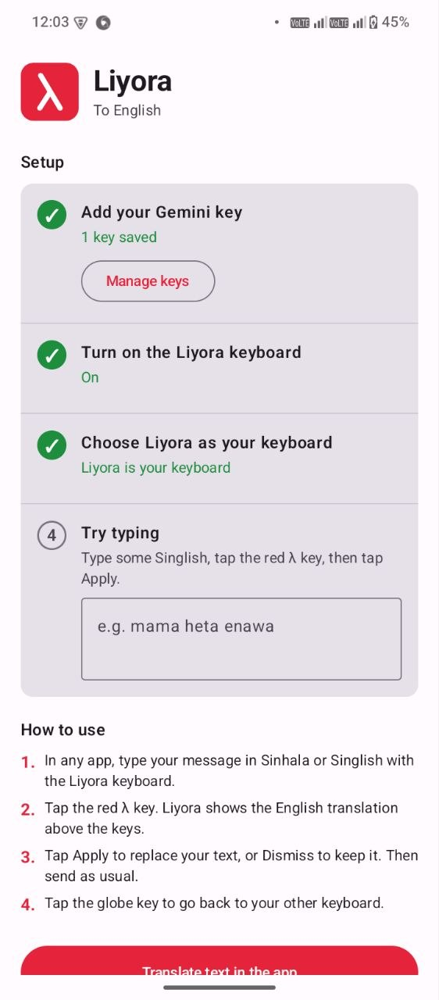
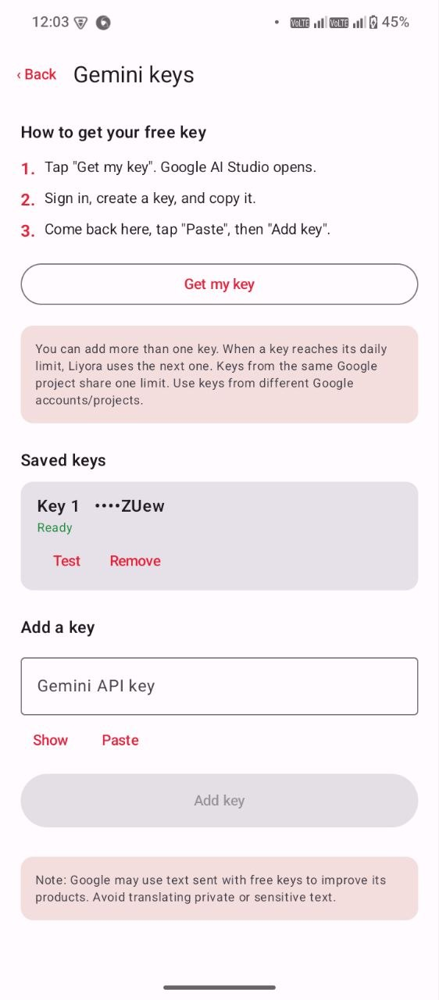
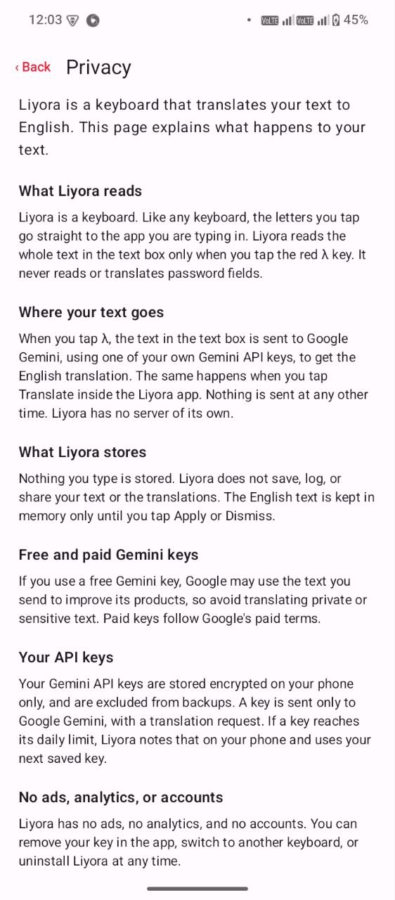
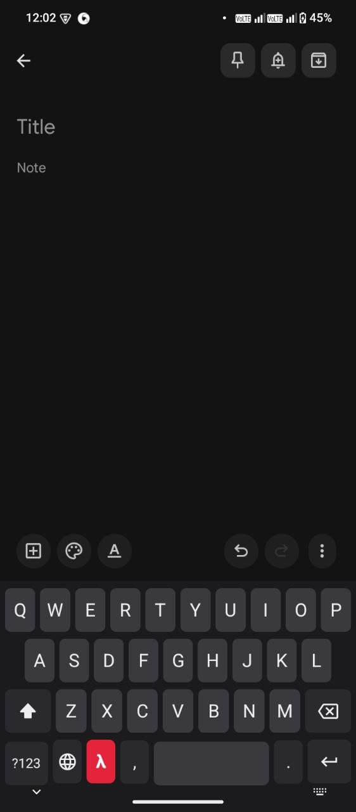
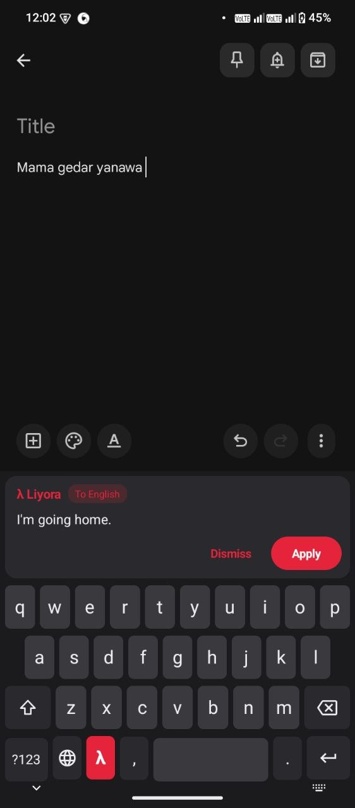
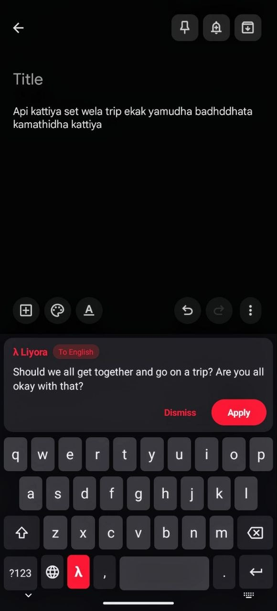

<div align="center">


# Liyora

**To English**

A keyboard for Android that translates what you type into English.

[](LICENSE)
[](#install)
[](https://github.com/chavindujayawardhana-pixel/liyora/releases/latest)

<a href="https://github.com/chavindujayawardhana-pixel/liyora/releases/latest"></a>
&nbsp;
<a href="https://chavindujayawardana.com.lk/liyora"></a>

</div>

---

## What is Liyora

Liyora is an Android keyboard that turns what you type into English. You can type in your own language, even in English letters (romanized text), such as Singlish (Sinhala written with English letters). Tap one key and Liyora shows the English translation.

It uses **your own free Gemini API key**. There is no Liyora server. Your text goes from your phone straight to Google Gemini, and nowhere else.

> v1.0.0 used an Accessibility bubble; v1.1.0 is a keyboard.

## Screenshots

<table>
  <tr>
    <td align="center"><br><sub>Setup in 4 steps</sub></td>
    <td align="center"><br><sub>Your Gemini keys</sub></td>
    <td align="center"><br><sub>Privacy, in the app</sub></td>
  </tr>
  <tr>
    <td align="center"><br><sub>The Liyora keyboard</sub></td>
    <td align="center"><br><sub>Tap λ: English above the keys</sub></td>
    <td align="center"><br><sub>Works on longer messages</sub></td>
  </tr>
</table>

## How it works

| | |
|:-:|---|
| **1** | Type your message in any app with the Liyora keyboard. |
| **2** | Tap the red **λ** key. |
| **3** | The English translation appears in a panel above the keys. |
| **4** | Tap **Apply** to replace your text with the English, or **Dismiss** to keep what you wrote. |

Liyora translates the **whole text in the field**, not just the last word. **Password fields are ignored**: Liyora never reads or translates them.

## Features

<table>
  <tr>
    <td width="50%"><b>🔑 Multiple Gemini keys</b><br>Add more than one key. When one hits its daily limit, Liyora switches to the next one automatically.</td>
    <td width="50%"><b>🔒 Keys encrypted on the phone</b><br>Keys are stored with EncryptedSharedPreferences and excluded from backups.</td>
  </tr>
  <tr>
    <td><b>🗑️ Nothing stored or logged</b><br>Your text and translations are never saved, logged or shared.</td>
    <td><b>🚫 No ads, analytics or accounts</b><br>No sign-up, no tracking, no ads.</td>
  </tr>
  <tr>
    <td><b>🔁 Model fallback</b><br>If one Gemini model is not available for your key, Liyora tries the next free model and remembers the one that works.</td>
    <td><b>🩺 Check key</b><br>One tap shows in plain words whether a key works, is invalid, reached its limit, or can't reach Gemini.</td>
  </tr>
  <tr>
    <td><b>☁️ No backend</b><br>The app talks only to Google Gemini, with your own key.</td>
    <td><b>🔐 Skips password fields</b><br>In a password field, λ shows a short note and sends nothing.</td>
  </tr>
</table>

## Install

> [!NOTE]
> Liyora is **not on Google Play**. You install the APK from GitHub. Google Play Protect may show a warning for apps installed outside the Play Store.

1. **Download** `Liyora-1.1.1.apk` from the [latest release](https://github.com/chavindujayawardhana-pixel/liyora/releases/latest) on your phone.
   Already have 1.1.0? Install 1.1.1 over it. Your keys stay saved.
2. **Open it** and, when Android asks, allow installing apps from this source (your browser or file manager). Then tap Install.
3. **Add a Gemini key.** Open Liyora, tap *Add key*, then *Get my key*. Sign in to [Google AI Studio](https://aistudio.google.com/apikey), create a free key, copy it, and paste it into Liyora.
4. **Turn on the keyboard.** In Liyora, tap *Open settings* and turn on Liyora. Android shows a standard warning for every keyboard; tap OK.
5. **Choose it.** Tap *Choose keyboard* and pick Liyora. Then try it in the *Try typing* field on the setup screen.

## Free Gemini key notes

- **Limits are per Google project and per model, not per key.** Keys from the same project share one limit. For more free translations per day, use keys from different Google accounts or projects.
- **Limits reset at midnight Pacific time.**
- **Only a limit reached on every model counts as "limit reached".** A short per-minute limit only means "wait a minute".
- **Free keys and privacy:** Google may use text sent with free keys to improve its products. Avoid translating private or sensitive text with a free key.

## Troubleshooting

Open Liyora, tap *Manage keys*, then **Check key** next to a key. Liyora sends a tiny test request and tells you what happened:

| Result | What to do |
|---|---|
| **works** (with the model name) | Nothing. The key is fine. |
| **not valid** | Copy the whole key again from Google AI Studio, or create a new one. |
| **refused** | The key is restricted, turned off or reported as leaked. Create a new key. |
| **today's free limit** | Wait until midnight Pacific time, or add a key from another Google account. |
| **models not available** | Try again later, or check for a Liyora update. |
| **not available in your country** | The Gemini API does not serve your region. Turn off any VPN. |
| **no internet / could not reach Gemini** | Check Wi-Fi or mobile data, and that Liyora may use data in your phone's app settings. |
| **secure connection failed** | Check that your phone's date and time are correct, or try another network. |

## Privacy

- Liyora reads the text field **only when you tap λ**, and never reads password fields.
- That text is sent **only to Google Gemini**, with your own key. Liyora has no server.
- Nothing you type is stored. The English text is kept in memory only until you tap Apply or Dismiss.
- Your keys are encrypted on your phone and excluded from backups.

Full policy: **[PRIVACY.md](PRIVACY.md)**.

## Tech stack

| | |
|---|---|
| Language | Kotlin |
| Keyboard | Android `InputMethodService` with a custom keyboard view |
| App screens | Jetpack Compose, Material 3 |
| Translation | Google Gemini API (REST): `gemini-3.8-flash`, then `gemini-3.6-flash`, then `gemini-3.5-flash-lite` |
| Key storage | `EncryptedSharedPreferences` (AndroidX Security) |
| Android | minSdk 26 (Android 8.0), targetSdk 36 |

## Build from source

You need **JDK 17** or newer (or Android Studio, which bundles one) and the Android SDK.

```bash
git clone https://github.com/chavindujayawardhana-pixel/liyora.git
cd liyora
./gradlew assembleDebug
```

The debug APK is written to `app/build/outputs/apk/debug/app-debug.apk`.

**Release builds** are signed with your own keystore, which is **not** in this repo. Copy `keystore.properties.example` to `keystore.properties` and fill in your keystore path, alias and passwords. Then run `./gradlew assembleRelease`. Without `keystore.properties`, the release APK is built unsigned. `keystore.properties` and `*.jks` files are git-ignored. Never commit them.

## Known limits

- You need **your own Gemini API key**.
- Free keys have **daily limits**.
- An **internet connection** is required to translate.
- Tested on **only a few phones** so far.
- Tested mostly with **Sinhala and Singlish**. The translation prompt is written for Sinhala, so how well other languages work depends on Gemini.
- Translation quality **depends on Gemini**, and it can make mistakes. Check important messages before you send them.

## Roadmap

Ideas, not promises:

- Typing Sinhala script from English letters on the Liyora keyboard itself
- Testing more languages

## License and credits

Released under the [MIT License](LICENSE). Copyright (c) 2026 Chavindu Jayawardana.

Translations by [Google Gemini](https://ai.google.dev/). Built with Kotlin, Jetpack Compose and AndroidX.
